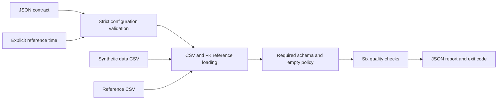

# Data Quality Gates

A personal educational project built with AI assistance: declarative JSON contracts turn synthetic CSV data into deterministic, machine-readable quality reports. It demonstrates local pipeline gates and CI exit codes. It contains no employer code or data and makes no claim of production use or business gains.

Python 3.11+; no runtime dependencies, cloud resources, SaaS accounts or credentials.

## Quickstart

Run from this repository. The examples use a fixed reference time so results remain reproducible in the future.

```bash
export PYTHONPATH=src
python3 -m unittest discover -s tests -v
python3 -m data_quality_gates --contract examples/contract.json --data examples/clean.csv --reference-time 2026-10-15T12:00:00Z
# Expected: status passed, 2 rows, zero violations; exit 0.
python3 -m data_quality_gates --contract examples/contract.json --data examples/dirty.csv --reference-time 2026-10-15T12:00:00Z
# Expected: status failed, 3 rows; exit 1 is intentional.
```

Optional installation for the `data-quality-gates` command:

```bash
python3 -m venv .venv
.venv/bin/python -m pip install -e .
.venv/bin/data-quality-gates --contract examples/contract.json --data examples/clean.csv --reference-time 2026-10-15T12:00:00Z
```

Add `--report report.json` to write the same JSON to a file. The containing directory must already exist. stdout always carries the report for normal evaluations and handled errors; argument-usage errors use argparse stderr. A report write error returns an input-error report on stdout and exit 3. Report files can contain row numbers and error paths; use trusted destinations.

| Exit | Meaning | Report status |
| --- | --- | --- |
| 0 | Data satisfies contract | `passed` |
| 1 | Parseable data violates quality expectations | `failed` |
| 2 | Contract malformed/unreadable, or bad CLI arguments | `config_error` for handled contract errors |
| 3 | CSV/reference time invalid or I/O fails | `input_error` |

All example records and reference values are synthetic. The dirty fixture has check violation counts `[1, 1, 3, 2, 2, 3]` in contract order. Counts can overlap; summing them does **not** give distinct bad records.

## Architecture



`evaluate(contract, data_path, reference_time, base_dir)` returns a JSON-compatible dict and raises `ConfigError` or `InputError` for invalid configuration or inputs. The CLI translates those exceptions into structured errors. FK file paths resolve relative to the contract file; the API uses its explicit `base_dir` argument. Absolute paths also work: contracts are trusted local configuration, not a path security boundary.

## Contract and check semantics

See [examples/contract.json](examples/contract.json) for a complete six-check contract. Top-level required keys are exactly `version` (integer 1), `required_columns` (nonempty distinct names), `empty_policy` (`allow` or `fail`) and `checks` (a list, optionally empty for schema-only gating). Each check has a nonblank unique `id`, a supported `type` and the type-specific keys below. Every checked column must appear in `required_columns`. Unknown/missing settings, typo check types, duplicate JSON keys, non-finite numbers, reversed bounds and malformed types are configuration errors, even for empty datasets. Bounds and maximum age must be JSON numbers, not strings or booleans.

| Type | Required settings beyond `id`/`type` | Failure semantics |
| --- | --- | --- |
| `not_null` | `columns`: nonempty distinct list | Row fails if any selected value is empty or whitespace only. |
| `unique` | `columns`: nonempty distinct list | Exact composite key; each occurrence after the first fails. All blank/whitespace-only values normalize to the same empty key component. Other strings preserve whitespace. |
| `numeric_range` | `column`, at least one of `min`/`max` | Finite decimal parsing; inclusive bounds. Null, NaN, Inf and malformed values fail as quality violations. Signs, decimal fractions and scientific notation supported; underscores and thousands separators rejected. |
| `allowed_values` | `column`, `values`: nonempty distinct nonblank strings | Exact string membership, with null always failing. |
| `foreign_key` | `column`, `reference_file`, `reference_column` | Exact membership in non-null reference values; null always fails. Reference duplicates are harmless. Missing/unreadable file or missing reference column is an input error. Empty reference table means no matching keys. |
| `freshness` | `column`, `max_age_seconds`: finite number >= 0 | Datetime age satisfies `0 <= age <= max_age_seconds`. Future, stale, invalid, naive or null timestamp fails. Offset-normalized comparison with microsecond precision. |

Timestamps use `YYYY-MM-DDTHH:MM:SS[.fraction](Z|+HH:MM|-HH:MM)`. Offsets require hours 00–23 and minutes 00–59; calendar/clock values must be valid. Leap seconds and named timezone/DST databases are unsupported. Python datetime truncates fractions beyond six digits. Invalid reference time is an input error; invalid cell timestamps are quality violations. System time never affects evaluations.

CSV inputs are UTF-8, comma-delimited, with one nonblank, unique header per column. Extra columns are permitted. Missing required columns produce a quality-failure report and skip all checks; malformed row width or quoting, duplicate headers and invalid UTF-8 are input errors. References are loaded before checking primary-data emptiness or schema, so broken references cannot hide behind an empty file. Header-only data follows `empty_policy`; zero-byte data is invalid input. Empty policy does not exempt an invalid header. Python's CSV reader ignores physically blank lines; an explicit empty CSV record with fields is evaluated normally.

Reports preserve contract order and include `rows`, normalized `reference_time`, `missing_columns`, `empty_violation`, and per-check `id`, `type`, `violations`, `rows`. Row identifiers are 1-based CSV record numbers including the header (first data record is 2), excluding ignored blank lines; quoted multiline fields count as a single record. The report lists every violation record, without cell-value samples.

## Verification and limits

[docs/verification.md](docs/verification.md) records actual local runs; [docs/implementation-plan.md](docs/implementation-plan.md) pins the interface and decisions. CI checks Python 3.11/3.12, the suite, clean exit 0 and intentional dirty exit 1. Remote CI is pending until this project is published and its workflow runs.

This is an in-memory local CSV gate. Time/memory grow with records, checks, reference keys and report size; there is no streaming, performance benchmark, database connector, distributed execution, sampling, scheduling, remediation, schema inference or full JSON Schema engine. UTF-8 BOM and alternate delimiters are unsupported. The contract language explicitly validates required settings but does not impose a dataset row limit. No cross-table consistency snapshot is guaranteed if files change during loading. Reports are regular file writes, not transactional replacements. Use immutable inputs and separate report destinations for reliable local runs.

MIT licensed.
